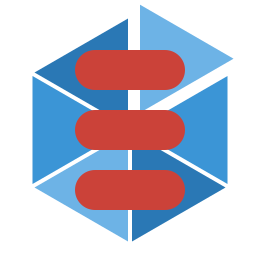

# &nbsp; Shard

**Shard** is a **Scala open source library** that makes it easy to distribute entities across multiple servers and interact with those entities using their ID without knowing their actual location (this is also known as *location transparency*). 

Shard exposes a **purely functional API** and depends heavily on [ZIO](https://zio.dev).

The [Documentation](https://ghostdogpr.github.io/shard/) explains how to use Shard, in particular:
- how to [get started](https://ghostdogpr.github.io/shard/getting-started)
- the [architecture](https://ghostdogpr.github.io/shard/architecture) behind Shard
- how to [configure](https://ghostdogpr.github.io/shard/config) it
- parts you can [customize](https://ghostdogpr.github.io/shard/customization)
